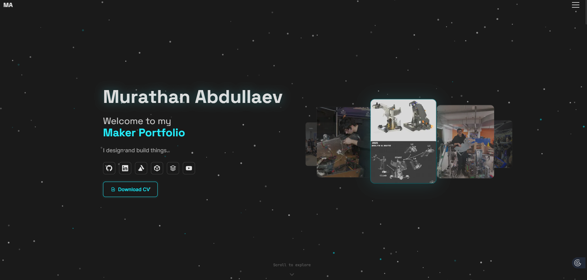
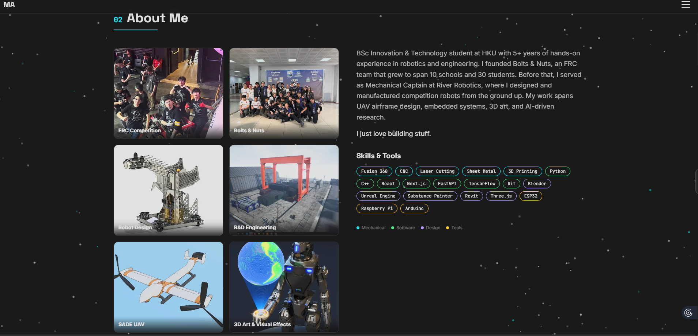
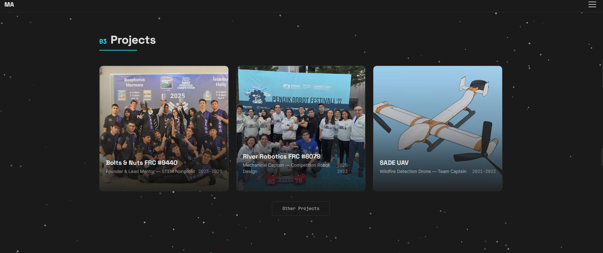
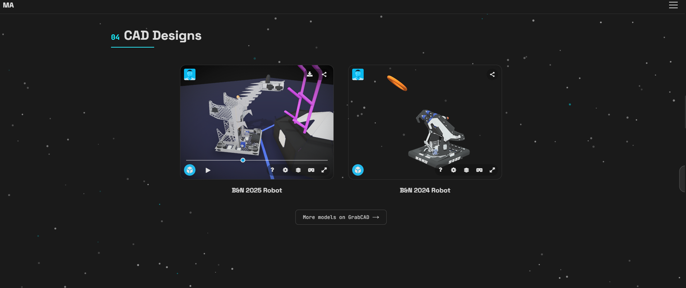
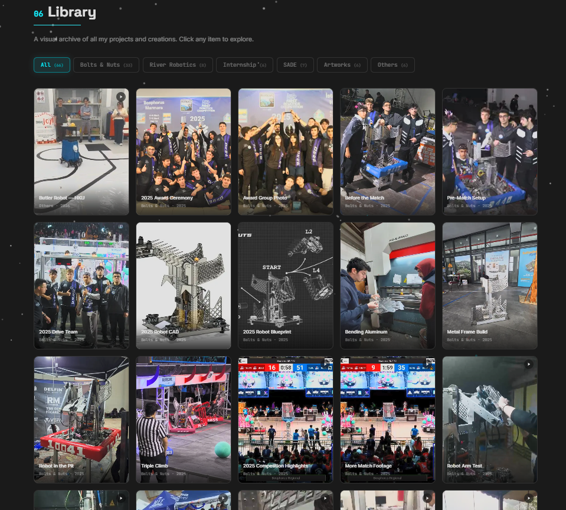

<p align="center">
  
</p>

<h1 align="center">Web Portfolio Template</h1>

<p align="center">
  A free, open-source portfolio website for engineers, designers, makers, and 3D artists.<br/>
  Dark theme. Animated. Interactive 3D model viewers. Fully responsive.<br/>
  <strong>Zero cost to deploy.</strong>
</p>

<p align="center">
  <a href="https://murathan.info">Live Demo</a> &nbsp;·&nbsp;
  <a href="#quick-start">Quick Start</a> &nbsp;·&nbsp;
  <a href="#customization-guide">Customization</a> &nbsp;·&nbsp;
  <a href="#deploy-for-free">Deploy</a> &nbsp;·&nbsp;
  <a href="https://github.com/Murathanx12/Web-Portfolio-Template/issues">Report Bug</a>
</p>

<p align="center">
  
  
  
  
</p>

---

## What You Get

| Section | Description |
|---------|-------------|
| **Hero** | Animated name reveal, social links, CV download, 3D image carousel |
| **About Me** | Flip-card grid + bio + color-coded skill pills |
| **Projects** | Filterable project cards with detail overlays |
| **CAD Designs** | Embedded Sketchfab 3D model viewers |
| **Poly Models** | ArtStation / external portfolio links |
| **Library** | Full media gallery with category filters, lightbox, video support |
| **Footer** | Contact info, social links, copyright |

<details>
<summary><strong>Screenshots</strong> (click to expand)</summary>
<br/>

**About Section**


**Projects**


**3D Model Viewer (Sketchfab)**


**Library / Gallery**


</details>

---

## Tech Stack

| Layer | Tool |
|-------|------|
| Framework | [Next.js 16](https://nextjs.org) (App Router, TypeScript) |
| Styling | [Tailwind CSS 4](https://tailwindcss.com) |
| 3D Rendering | [Three.js](https://threejs.org) + [@react-three/fiber](https://docs.pmnd.rs/react-three-fiber) + [Drei](https://github.com/pmndrs/drei) |
| Animation | [Framer Motion](https://www.framer.com/motion/) |
| 3D Embeds | [Sketchfab](https://sketchfab.com) (free tier) |
| Fonts | Space Grotesk, Inter, JetBrains Mono (via `next/font`) |

---

## Quick Start

### Prerequisites

- [Node.js](https://nodejs.org) 18+ installed
- [Git](https://git-scm.com) installed

### 1. Clone or Fork

```bash
# Option A: Fork this repo on GitHub, then clone your fork
git clone https://github.com/YOUR-USERNAME/Web-Portfolio-Template.git
cd Web-Portfolio-Template

# Option B: Clone directly
git clone https://github.com/Murathanx12/Web-Portfolio-Template.git
cd Web-Portfolio-Template
```

### 2. Install Dependencies

```bash
npm install
```

### 3. Start the Dev Server

```bash
npm run dev
```

Open [http://localhost:3000](http://localhost:3000) — you should see the template with placeholder content.

### 4. Make It Yours

Edit the data files in `src/data/` — that's where all your content lives. No need to touch the components unless you want to change the layout. See the [Customization Guide](#customization-guide) below.

### 5. Deploy

```bash
npm run build   # make sure it builds clean
```

Then push to GitHub and connect to Vercel (free). See [Deploy for Free](#deploy-for-free).

---

## Customization Guide

All your content lives in **5 data files**. You rarely need to touch the components.

### File Map

| File | What It Controls |
|------|-----------------|
| `src/data/projects.ts` | **Projects + Personal Info** — your name, bio, social links, and all project entries |
| `src/data/about.ts` | **About Section** — flip card highlights and skills list |
| `src/data/cad.ts` | **CAD Designs** — Sketchfab 3D model embeds |
| `src/data/gallery.ts` | **Library** — all gallery images and videos |
| `src/data/polymodels.ts` | **Poly Models** — ArtStation/external 3D art links |

### Step-by-Step Personalization

#### 1. Update Your Identity (`src/data/projects.ts`)

```typescript
export const personalInfo = {
  name: "Jane Doe",                              // Your full name
  title: "Mechanical Engineer & 3D Artist",      // Your title
  tagline: "I design and build things.",          // One-liner
  bio: "Your bio goes here...",                   // 2-3 paragraphs
  email: "jane@example.com",                     // Contact email
  links: {
    linkedin: "https://linkedin.com/in/janedoe",
    github: "https://github.com/janedoe",
    artstation: "https://www.artstation.com/janedoe",
    sketchfab: "https://sketchfab.com/janedoe",
    grabcad: "https://grabcad.com/janedoe",
    youtube: "https://www.youtube.com/@janedoe",
  },
};
```

#### 2. Update the Navbar Initials (`src/components/global/Navbar.tsx`)

Find the line that says `YN` and change it to your initials.

#### 3. Update Page Metadata (`src/app/layout.tsx`)

```typescript
export const metadata: Metadata = {
  title: "Jane Doe — Mechanical Engineer & 3D Artist",
  description: "Portfolio of Jane Doe — robotics, CAD, and 3D art.",
};
```

#### 4. Add Your Projects (`src/data/projects.ts`)

Each project is an object in the `projects` array. Copy an existing entry and modify it. The template includes 5 sample projects to show you the format.

#### 5. Add Your Images

Place your images in the `public/` directory:

```
public/
├── images/
│   ├── hero/           ← Hero carousel images (recommended: 8 images)
│   ├── gallery/
│   │   └── <category>/ ← Gallery images sorted by project/category
│   ├── video-thumbs/   ← Thumbnail images for videos
│   └── cad/            ← CAD model thumbnails
├── videos/             ← MP4 video files
└── cv.pdf              ← Your resume/CV
```

**Image tips:**
- Use JPG at 80% quality, 1200-1600px wide
- Compress videos to 720p with `ffmpeg` or HandBrake
- Keep total repo size under 500MB for fast deploys

#### 6. Add 3D Models (`src/data/cad.ts`)

Upload your models to [Sketchfab](https://sketchfab.com) (free), then:

```typescript
{
  id: "my-robot",
  title: "My Competition Robot",
  sketchfabId: "abc123def456...",  // From the Sketchfab URL
  // ... other fields
}
```

#### 7. Customize Skills (`src/data/about.ts`)

Add, remove, or recategorize skills. Categories control the color-coding:
- `mechanical` — teal
- `software` — blue
- `design` — purple
- `tools` — amber

---

## Deploy for Free

### Vercel (Recommended)

The easiest option — automatic deploys on every push.

1. Push your repo to GitHub
2. Go to [vercel.com](https://vercel.com) and sign in with GitHub
3. Click **"New Project"** → import your repo
4. Click **Deploy** — done

**Cost: $0** on the Hobby plan (unlimited personal projects).

**Custom domain:** You can connect your own domain in Vercel settings. Domains cost ~$10-15/year from providers like Namecheap, Cloudflare, or Google Domains.

### Netlify

1. Push to GitHub
2. Go to [netlify.com](https://netlify.com) → New site from Git
3. Build command: `npm run build`
4. Publish directory: `.next`

**Cost: $0** on the free tier.

### Cloudflare Pages

1. Push to GitHub
2. Go to [Cloudflare Pages](https://pages.cloudflare.com)
3. Connect your repo, set build command to `npm run build`

**Cost: $0** on the free tier.

### Self-Hosted

```bash
npm run build
npm run start    # Runs on port 3000
```

Use with Nginx, Caddy, or any reverse proxy.

---

## Paid Upgrades (Optional)

The template is fully functional for free. Here are optional upgrades if you want more:

| Upgrade | Cost | What You Get |
|---------|------|-------------|
| **Custom domain** | ~$10-15/year | `yourname.com` instead of `yourname.vercel.app` |
| **Vercel Pro** | $20/month | Analytics, more bandwidth, team features |
| **Sketchfab Pro** | $15/month | Private models, download tracking, custom viewer branding |
| **Email service** | $0-5/month | Contact form via Resend, SendGrid, or Formspree |
| **CMS integration** | $0-29/month | Manage content via Sanity, Contentful, or Notion |
| **Analytics** | $0-9/month | Vercel Analytics, Plausible, or PostHog |

### Adding a Contact Form

Want a working contact form instead of just an email link?

**Free option — Formspree:**
1. Sign up at [formspree.io](https://formspree.io)
2. Create a form, get your endpoint
3. Add a `<form action="https://formspree.io/f/YOUR_ID" method="POST">` to the footer

**Code option — API Route + Resend:**
```typescript
// src/app/api/contact/route.ts
import { Resend } from 'resend';

const resend = new Resend(process.env.RESEND_API_KEY);

export async function POST(req: Request) {
  const { name, email, message } = await req.json();
  await resend.emails.send({
    from: 'Portfolio <noreply@yourdomain.com>',
    to: 'you@example.com',
    subject: `Portfolio Contact: ${name}`,
    text: `From: ${name} (${email})\n\n${message}`,
  });
  return Response.json({ success: true });
}
```

### Adding a Blog

Want to write articles alongside your portfolio?

**Option 1 — MDX (free, in-repo):**
- Install `@next/mdx`
- Create `src/app/blog/[slug]/page.mdx` files
- Write in Markdown with React components

**Option 2 — Headless CMS:**
- [Sanity](https://sanity.io) — free tier with visual editor
- [Notion as CMS](https://notion.so) — use the Notion API to pull content

### Adding Analytics

```bash
npm install @vercel/analytics
```

```typescript
// src/app/layout.tsx
import { Analytics } from '@vercel/analytics/react';
// Add <Analytics /> inside your <body>
```

---

## Project Structure

```
├── src/
│   ├── app/
│   │   ├── layout.tsx          ← Root layout, metadata, fonts
│   │   ├── page.tsx            ← Main page (all sections)
│   │   └── globals.css         ← Tailwind + custom theme
│   ├── components/
│   │   ├── hero/               ← Hero section, social icons, 3D carousel
│   │   ├── about/              ← About section, flip cards, skill pills
│   │   ├── projects/           ← Project cards and detail views
│   │   ├── cad/                ← Sketchfab 3D model viewers
│   │   ├── polymodels/         ← ArtStation model links
│   │   ├── library/            ← Gallery with filters and lightbox
│   │   ├── global/             ← Navbar, scroll animations, shared UI
│   │   └── Footer.tsx          ← Footer with contact info
│   ├── data/                   ← YOUR CONTENT LIVES HERE
│   │   ├── projects.ts         ← Projects + personal info
│   │   ├── about.ts            ← Flip cards + skills
│   │   ├── cad.ts              ← CAD model entries
│   │   ├── gallery.ts          ← Gallery items
│   │   └── polymodels.ts       ← Poly model links
│   └── hooks/                  ← Custom React hooks
├── public/
│   ├── images/                 ← All images (hero, gallery, thumbnails)
│   ├── videos/                 ← Video files
│   └── cv.pdf                  ← Your resume
├── docs/                       ← Screenshots for this README
├── package.json
├── next.config.ts
├── tsconfig.json
└── tailwind + postcss configs
```

---

## FAQ

<details>
<summary><strong>Do I need to know React/Next.js to use this?</strong></summary>

Not really. All your content goes in the `src/data/` files, which are plain TypeScript objects. If you can edit JSON, you can use this template. The components handle all the rendering.

</details>

<details>
<summary><strong>Can I remove sections I don't need?</strong></summary>

Yes. Open `src/app/page.tsx` and comment out or remove the section components you don't want. For example, if you don't have CAD models, remove the `<CADSection />` line.

</details>

<details>
<summary><strong>How do I change the accent color?</strong></summary>

The cyan accent is defined in `src/app/globals.css` as a CSS variable. Search for `--cyan` or `#00f0ff` and change it to your preferred color.

</details>

<details>
<summary><strong>Can I use this for a non-engineering portfolio?</strong></summary>

Absolutely. The template works for any visual portfolio — photography, architecture, game dev, industrial design, etc. Just change the section labels and data.

</details>

<details>
<summary><strong>Is the Sketchfab viewer required?</strong></summary>

No. If you don't have 3D models on Sketchfab, just remove the CAD section from `page.tsx` or leave the `cadModels` array empty.

</details>

<details>
<summary><strong>How do I add more social links?</strong></summary>

Edit `src/data/projects.ts` → `personalInfo.links` to add new URLs. Then add the corresponding icon in `src/components/hero/SocialIcons.tsx`. SVG icons for most platforms can be found at [simpleicons.org](https://simpleicons.org).

</details>

---

## Showcase

Built something with this template? [Open a PR](https://github.com/Murathanx12/Web-Portfolio-Template/pulls) to add your site here!

| Site | Author | Description |
|------|--------|-------------|
| [murathan.info](https://murathan.info) | Murathan Abdullaev | The original — robotics engineer & 3D artist |
| *Your site here* | *Your name* | *What you do* |

---

## Contributing

Contributions are welcome! See [CONTRIBUTING.md](CONTRIBUTING.md) for guidelines.

- Found a bug? [Open an issue](https://github.com/Murathanx12/Web-Portfolio-Template/issues/new?template=bug_report.md)
- Have an idea? [Request a feature](https://github.com/Murathanx12/Web-Portfolio-Template/issues/new?template=feature_request.md)
- Want to help? Fork, fix, and PR

---

## How to Support This Project

If this template helped you, here's how you can give back:

- **Star this repo** — it helps others find it
- **Fork it** — make it your own
- **Share it** — post on Twitter, Reddit, LinkedIn, Discord
- **Add your site to the showcase** — open a PR
- **Report bugs or suggest features** — open an issue
- **Contribute code** — PRs welcome

---

## License

[MIT](LICENSE) — use it however you want, for free, forever.

---

<p align="center">
  Built by <a href="https://github.com/Murathanx12">Murathan Abdullaev</a><br/>
  If you found this useful, a star goes a long way.
</p>
